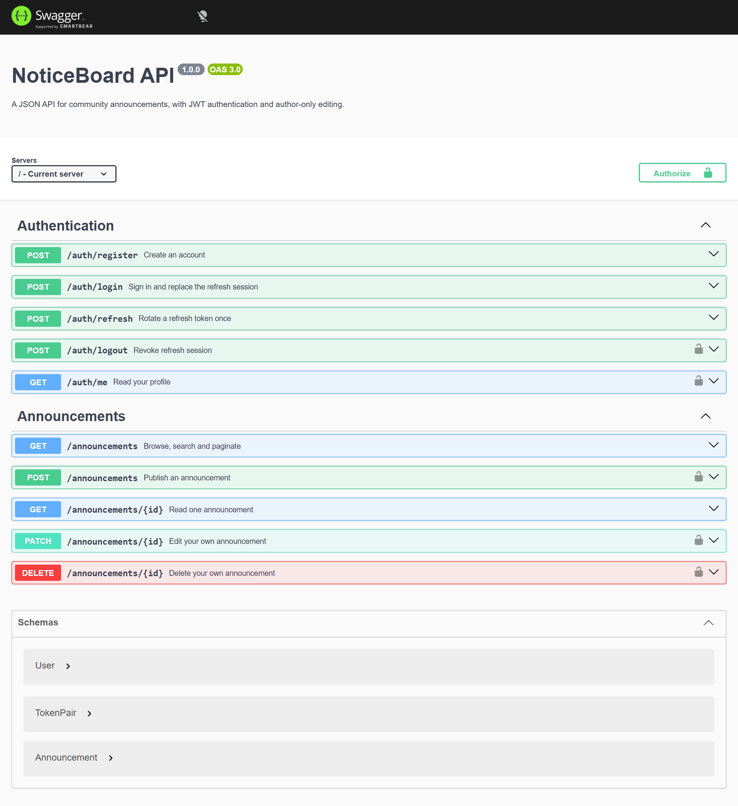
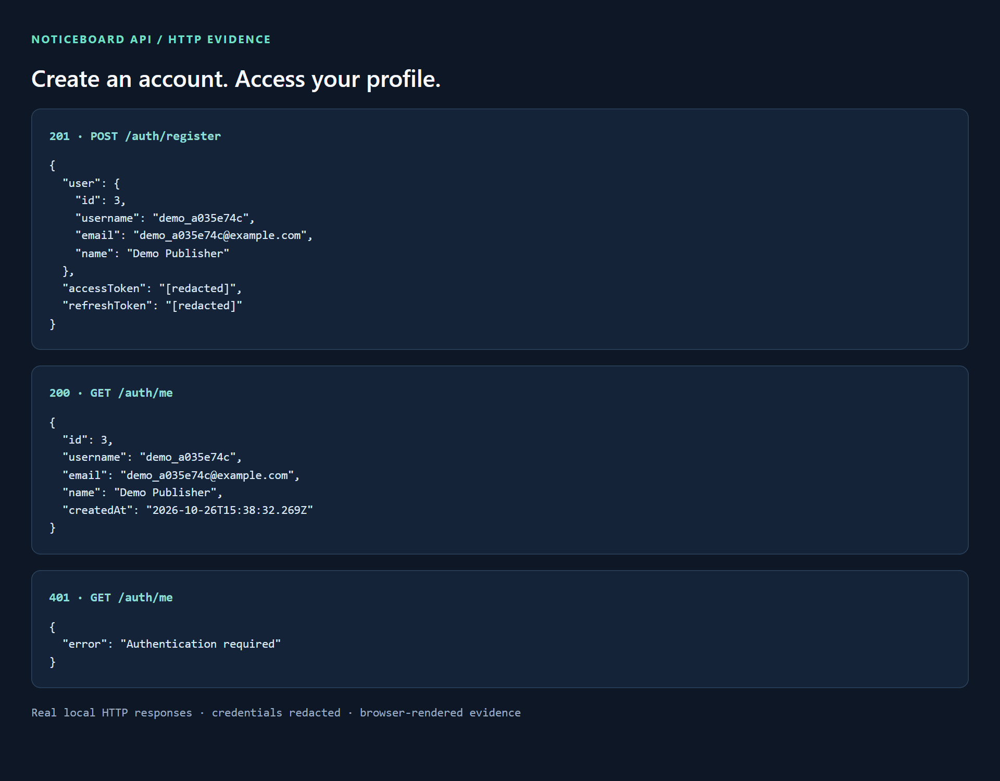
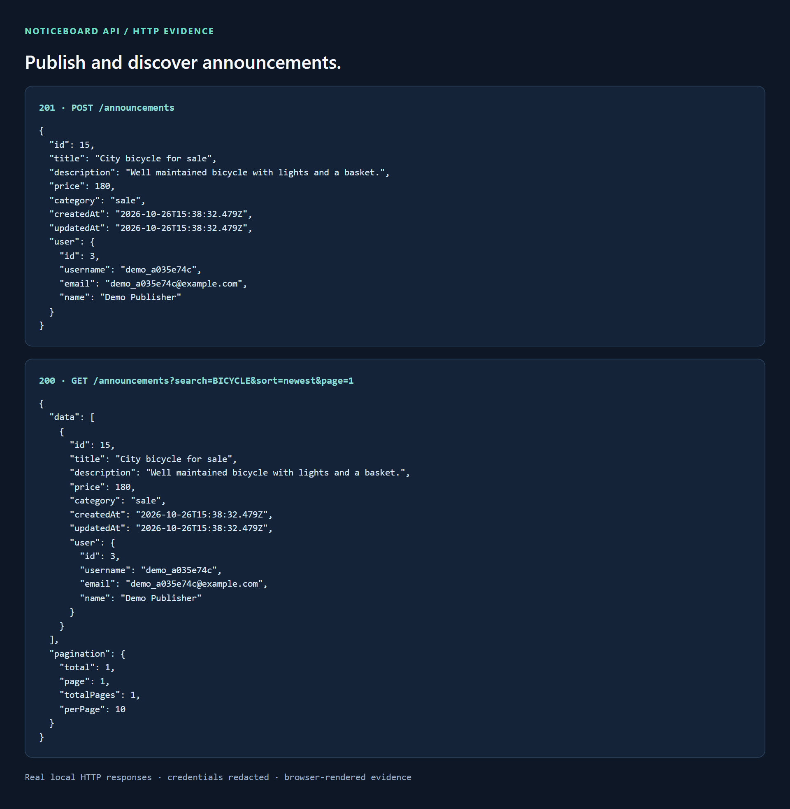
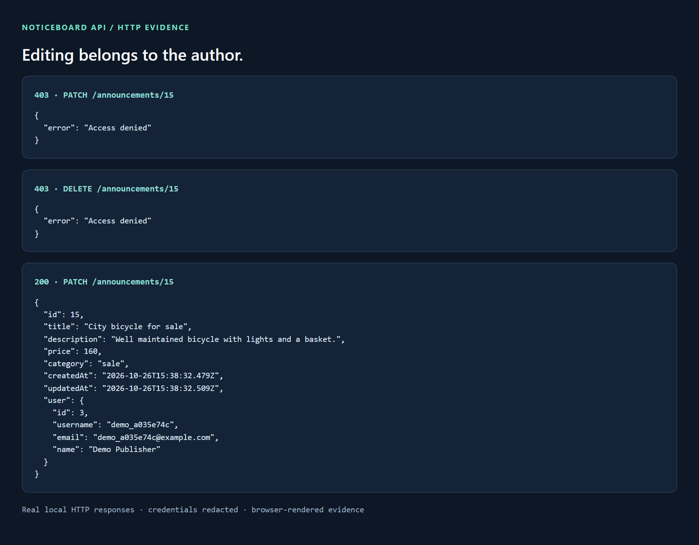
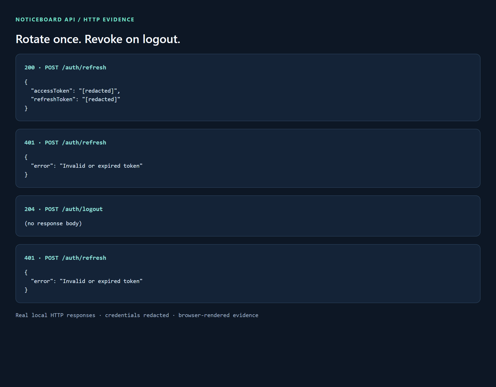

# NoticeBoard API

**A place for offers, services and opportunities. A clear API behind every post.**

NoticeBoard is a TypeScript REST API for a community announcement board. Visitors can browse and search listings. Registered members can publish announcements and manage their own posts. JWT authentication, rotating refresh tokens and ownership checks keep those responsibilities explicit.

The application serves JSON. Its only HTML page is the interactive API reference at `/api-docs`.

## What it does

- **Publish and manage listings:** create, read, partially update and delete announcements in four categories.
- **Find relevant posts:** case-insensitive title search, newest/oldest sorting and ten results per page.
- **Authenticate members:** bcrypt passwords, 15-minute access tokens and 7-day refresh tokens.
- **Protect authorship:** only the author can edit or delete a post; the client cannot assign a different author.
- **Rotate refresh sessions:** a token is consumed once, including when refresh requests arrive concurrently.
- **Explore the contract:** all ten operations are documented in OpenAPI with interactive Swagger UI.

## Technology

Node.js · TypeScript · Express 5 · PostgreSQL · Prisma 7 · Zod · bcrypt · jsonwebtoken · OpenAPI 3

The project starts from the [BetterED-Neoversity REST API boilerplate](https://github.com/BetterED-Neoversity/Boilerplate-REST-API-Nodejs). Its configuration and stack are retained, with compatible dependency updates and the application implementation added here.

## Run locally

**Requirements:** Node.js 22.12 or newer (or a newer supported LTS release), npm, and Docker Desktop with Linux containers. You can also use an existing PostgreSQL database instead of Docker.

```sh
git clone https://github.com/vikkrat/woolf-node-noticeboard-api.git
cd woolf-node-noticeboard-api
npm ci
```

Copy `.env.example` to `.env`:

```powershell
# PowerShell
Copy-Item .env.example .env
```

```sh
# macOS / Linux
cp .env.example .env
```

Generate a signing secret and paste the output into `JWT_SECRET` in `.env`:

```sh
node -e "console.log(require('node:crypto').randomBytes(48).toString('hex'))"
```

Then start the database, generate the Prisma client and apply the committed migration:

```sh
npm run db:up
npm run prisma:generate
npm run prisma:deploy
npm run dev
```

Open **[http://localhost:3000/api-docs](http://localhost:3000/api-docs)**. The raw specification is available at **[http://localhost:3000/openapi.json](http://localhost:3000/openapi.json)**.

The server binds to `127.0.0.1`. PostgreSQL is exposed on local port `54329`, isolated from an existing database on the usual port `5432`. Docker data is stored in the project's named volume. `npm run db:down` stops the container and preserves that volume.

### Configuration

| Variable | Purpose |
| --- | --- |
| `DATABASE_URL` | PostgreSQL connection URL; the example matches `compose.yaml` |
| `JWT_SECRET` | Random secret of at least 32 characters; the placeholder is rejected |
| `PORT` | HTTP port, default `3000` |

The Docker username and password are for local development. `.env` is ignored by Git. Use separate credentials and secrets for any deployment.

## Try the API

Swagger UI lets you run every request without a separate client:

1. Open `POST /auth/register`, choose **Try it out**, and submit a username, email, password and name.
2. Copy the returned `accessToken`.
3. Click **Authorize** and paste the token itself; Swagger adds the `Bearer` prefix.
4. Create an announcement with `POST /announcements`, then browse or update it.
5. Submit the returned refresh token to `POST /auth/refresh` when a new pair is needed. Save the new pair: the old refresh token no longer works.

Example registration payload:

```json
{
  "username": "marta_dev",
  "email": "marta@example.com",
  "password": "A-long-example-password",
  "name": "Marta"
}
```

Example announcement payload:

```json
{
  "title": "City bicycle for sale",
  "description": "Well maintained bicycle with lights and a basket.",
  "price": 180,
  "category": "sale"
}
```

Public requests need no token:

```sh
curl "http://localhost:3000/announcements?search=bicycle&sort=newest&page=1"
curl "http://localhost:3000/announcements/1"
```

In Windows PowerShell, use `curl.exe` when `curl` is an alias. For protected requests, send `Authorization: Bearer <accessToken>` and use `Content-Type: application/json` for JSON bodies.

### Routes

| Method | Route | Access | Success |
| --- | --- | --- | --- |
| POST | `/auth/register` | Public | `201` user and token pair |
| POST | `/auth/login` | Public | `200` user and token pair |
| POST | `/auth/refresh` | Valid refresh token in JSON body | `200` new token pair |
| POST | `/auth/logout` | Access token | `204` empty body |
| GET | `/auth/me` | Access token | `200` profile |
| GET | `/announcements` | Public | `200` data and pagination |
| GET | `/announcements/:id` | Public | `200` post and author |
| POST | `/announcements` | Access token | `201` created post |
| PATCH | `/announcements/:id` | Author only | `200` updated post |
| DELETE | `/announcements/:id` | Author only | `204` empty body |

### Validation and responses

Registration requires a username of 3–30 characters, a valid email, a name of 2–100 characters, and a password of at least 6 characters and at most 72 UTF-8 bytes. Email addresses are normalized to lowercase. Usernames are case-sensitive. Passwords are hashed with bcrypt at cost 12 and never returned.

Announcements require a title of 5–50 characters, a description of 10–10,000 characters, a finite positive numeric price, and one of `sale`, `service`, `job`, or `other`. Prices are numeric amounts; this API does not define a currency or process payments. PATCH accepts the same fields optionally, but requires at least one. Unknown body fields, including `userId`, are rejected.

`page` is a positive integer and defaults to `1`; `sort` is `newest` or `oldest` and defaults to `newest`. `search` matches a literal title substring, case-insensitively; omitted or empty search includes all posts. Equal timestamps use IDs as a stable sorting tie-breaker. A page beyond the results returns an empty array.

```json
{
  "data": [],
  "pagination": {
    "total": 0,
    "page": 1,
    "totalPages": 0,
    "perPage": 10
  }
}
```

Errors use `{ "error": "message" }`; validation responses also include a `details` array with field names and messages. Expected codes are `400` for invalid input, `401` for authentication failures, `403` for non-owner changes, `404` for missing resources and `409` for duplicate usernames or emails. Invalid JSON returns JSON error details; request bodies are limited to 32 KiB.

### Session lifecycle

Only one refresh session is active per account. Successful login replaces it. Refresh verifies the signature, expiry, issuer, audience and token type, then atomically replaces the matching stored token. Unique token IDs ensure rotation also works within the same second. Two concurrent refresh requests using one token yield one success and one `401`.

Logout removes refresh sessions idempotently. Already-issued access tokens remain valid until their 15-minute expiry; logout does not claim to revoke stateless access tokens. Refresh tokens cannot be used as access tokens. The database stores refresh-token values to support exact lookup and rotation; treat database access as sensitive.

## Execution gallery

The first image is an actual browser capture of Swagger UI. The other four are browser-rendered records of **real local HTTP responses**, not screenshots of a terminal or a separate frontend. Credentials are redacted. The companion JSON files preserve the response evidence. Demo users and their posts are removed after each run.

### Interactive API reference



### Registration and protected profile



[Response evidence](screenshots/02-authentication.json)

### Publish and search announcements



[Response evidence](screenshots/03-announcements.json)

### Ownership protection



[Response evidence](screenshots/04-ownership.json)

### Refresh rotation and logout



[Response evidence](screenshots/05-token-lifecycle.json)

## Verification

With the database running and migrations applied:

```sh
npm run typecheck
npm test
npm run demo
```

The integration suite runs against real PostgreSQL and an HTTP server on a temporary local port. Its ten scenarios cover registration and bcrypt storage, uniqueness and validation, login invalidation, concurrent refresh rotation, expired and wrong-purpose tokens, author attribution, search/sort/pagination, ownership and partial updates, logout, and OpenAPI/error handling. Each run creates uniquely named users and deletes only those users and their related records afterward. Use a local development database for tests.

`npm run demo` saves redacted response evidence in `screenshots/` and cleans up its temporary records. `scripts/capture-docs.cjs` is an optional documentation utility requiring Playwright and a browser. Start the API on port 3000 before using it; `CAPTURE_BROWSER_CHANNEL=msedge` selects installed Edge. Application execution and tests do not require Playwright.

## Project layout

```text
noticeboard-api/
├── app.ts                         Server startup and shutdown
├── compose.yaml                   Isolated local PostgreSQL
├── prisma.config.ts               Prisma CLI configuration
├── prisma/
│   ├── schema.prisma              User, RefreshToken, Announcement
│   ├── client.ts                  Shared database connection pool
│   └── migrations/                Versioned SQL migrations
├── src/
│   ├── app.ts                     Express assembly and error handling
│   ├── config.ts                  Environment validation
│   ├── errors.ts                  Intentional HTTP errors
│   ├── controllers/               Authentication and announcement operations
│   ├── middleware/                Bearer authentication and Zod validation
│   ├── routes/                    HTTP route definitions
│   ├── services/tokens.ts         JWT issuance and verification
│   ├── validators/                Body, parameter and query schemas
│   └── openapi.ts                 All ten documented operations
├── test/api.test.ts               HTTP and database integration tests
├── scripts/                       Reproducible demo and capture utilities
└── screenshots/                   Embedded images and redacted JSON evidence
```

Controllers explicitly select public user fields. Validation results live in `res.locals` because Express 5 exposes `req.query` as a getter. Prisma enforces unique usernames, emails and refresh sessions; transactions keep registration atomic and list/count results consistent. Foreign keys link announcements and sessions to their users, and `@updatedAt` maintains update timestamps.

### npm scripts

| Script | Purpose |
| --- | --- |
| `npm run dev` | Start with automatic reload |
| `npm start` | Start without reload |
| `npm run db:up` | Start PostgreSQL and wait for readiness |
| `npm run db:down` | Stop PostgreSQL, retaining data |
| `npm run prisma:generate` | Generate the Prisma client |
| `npm run prisma:deploy` | Apply committed migrations |
| `npm run prisma:migrate -- --name change_name` | Create a development migration after schema changes |
| `npm run typecheck` | Check TypeScript without emitting files |
| `npm test` | Run the integration suite |
| `npm run demo` | Record real HTTP flows with temporary data |

This repository is a local, portfolio-ready API implementation. A public deployment would additionally need HTTPS termination, authentication rate limits, secret management, operational monitoring and an explicit CORS policy for its frontend clients.
